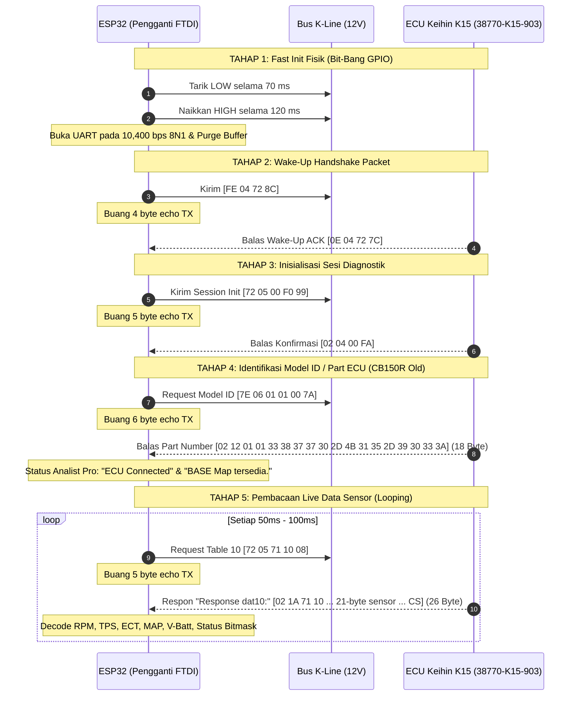

# Panduan Protokol K-Line Analist Pro ke ECU Honda CB150R Old (K15 / 38770-K15-903)
## Implementasi & Referensi Penggantian FTDI ke Mikrokontroler (ESP32)

Dokumen ini adalah dokumentasi teknis resmi alur komunikasi K-Line antara perangkat lunak **ANALIST Pro 5.1.0** dengan ECU Honda CB150R Old (Part Number: `38770-K15-903` / `38770-K15-921`), yang diekstrak langsung dari biner `ANALIST_Pro5.1.0.exe` dan skematik kabel interface `Reversed.kicad_sch`.

Dokumen ini disusun sebagai panduan migrasi dari kabel USB-FTDI ke mikrokontroler (ESP32).

---

## 1. Spesifikasi Lapisan Fisik (Hardware & Physical Layer)

Berdasarkan skematik `Reversed.kicad_sch` pada kabel remap bawaan Analist Pro:

| Parameter | Nilai / Konfigurasi | Keterangan Teknis |
| :--- | :--- | :--- |
| **Bus Komunikasi** | K-Line (ISO 9141 / KWP2000 Single Wire) | Komunikasi 1-kawat *half-duplex* (TX & RX berbagi bus yang sama) |
| **Tegangan Bus Idle** | **`+12V` (Baterai Motor)** | Ditarik ke 12V via resistor pull-up 2.2 kΩ pada adapter |
| **Tegangan Bus Aktif** | **`0V` (Ground / LOW)** | Ditarik ke ground oleh transistor saat bit LOW ditransmisikan |
| **Rangkaian Interface** | 2x Transistor NPN (BC546) | Mengonversi sinyal 3.3V/5V TTL menjadi sinyal 12V K-Line |
| **Logika UART** | Active LOW / Inverted Line | Kondisi idle UART adalah HIGH (3.3V/5V), di K-Line menjadi 12V |
| **Baud Rate Utama** | **`10,400 bps`** | Kecepatan komunikasi standar ECU Keihin Honda |
| **Format Serial** | **`8N1`** | 8 Data bit, No parity, 1 Stop bit |
| **Sifat Bus Echo** | **Self-Echo Aktif** | Setiap byte yang dikirim TX akan langsung terpantul ke RX |

---

## 2. Diagram Alur Urutan Komunikasi (ANALIST Pro Flow)



---

## 3. Rincian Langkah Komunikasi & Frame Heksadesimal

### TAHAP 1: Fast Init Fisik (Hardware Wake-Up Pulse)
Di Analist Pro, pulsa ini dilakukan oleh driver FTDI menggunakan `FT_SetBitMode`
(bit-bang), bukan framing UART biasa. Implementasi firmware ESP32 di repository
ini menjaga TX tetap tersambung ke periferal UART: baud sementara dihitung
sebagai `9 / durasi_LOW`, lalu satu byte `0x00` membentuk sekitar sembilan bit
LOW. Stop bit dan level idle UART membentuk fase HIGH. Baud dikembalikan ke
10400 setelah fase HIGH; jalur TX tidak dialihkan ke GPIO selama Fast Init.

1. **Fase LOW:** Tarik jalur K-Line ke ground (**0V**) selama **`70 ms`** (toleransi: 65 s/d 75 ms).
   * *Catatan Penting:* Durasi 25 ms ISO-14230 standar mobil **gagal** di ECU Keihin karena filter internal ECU menganggapnya noise.
2. **Fase HIGH:** Kembalikan jalur K-Line ke kondisi idle (**12V**) selama **`120 ms`** (toleransi: 100 s/d 130 ms).
3. **UART Fast Init pada ESP32:** Dengan UART tetap terpasang, set baud sementara
   sehingga sembilan bit LOW sesuai durasi yang dipilih, kirim `0x00`, tunggu
   TX selesai, pertahankan HIGH sampai durasi fase HIGH, lalu pulihkan baud
   `10400 bps` 8N1. Pola `0x00` ini menghasilkan pulsa fisik Fast Init, bukan
   byte frame KWP atau preamble. Byte `0x00`/`0x01` yang tampak di awal capture
   bit-bang FTDI tidak direplay sebagai byte data; `0x01` mandiri tidak dikirim
   firmware.
4. **Purge Buffer:** Setelah pulsa selesai, firmware membaca pending RX dan
   mencatatnya ke Raw RX sebelum flush. Karena RX UART tidak diarahkan ke idle
   buatan, byte yang didekode saat Fast Init dapat dicatat bila driver menerima.

---

### TAHAP 2: Wake-Up Handshake Frame

Aplikasi mengirim frame 4-byte pendek untuk mengonfirmasi bangunnya ECU.

* **TX (Dikirim oleh Tool / ESP32):**
  ```text
  FE 04 72 8C
  ```
  * `0xFE` : Header Wake-up khusus Honda
  * `0x04` : Panjang frame total (4 byte)
  * `0x72` : Destination Address (ID Target ECU Keihin)
  * `0x8C` : Checksum 2's Complement: `0x100 - (0xFE + 0x04 + 0x72) = 0x8C`

* **RX (Yang HARUS Dibalas oleh ECU K15):**
  ```text
  0E 04 72 7C
  ```
  * `0x0E` : Header Konfirmasi Bangun (Wake-up ACK) dari ECU
  * `0x04` : Panjang frame (4 byte)
  * `0x72` : Target echo
  * `0x7C` : Checksum ECU: `0x100 - (0x0E + 0x04 + 0x72) = 0x7C`

> **Kriteria Berhasil Tahap 2:**
> Jika `0E 04 72 7C` terbaca, ECU resmi dalam kondisi aktif. Jika timeout atau tidak ada byte balasan, aplikasi Analist Pro menampilkan `ECM NOT CONNECT` / `Please Kontak ON`.

---

### TAHAP 3: Inisialisasi Sesi Diagnostik (Session Init)

Mengunci ECU agar masuk ke mode diagnostik interaktif.

* **TX (Dikirim oleh Tool / ESP32):**
  ```text
  72 05 00 F0 99
  ```
  * `0x72` : Header Destination (ECU)
  * `0x05` : Panjang frame (5 byte)
  * `0x00` : Command Diagnostic Session Start
  * `0xF0` : Parameter inisialisasi sesi
  * `0x99` : Checksum: `0x100 - (0x72 + 0x05 + 0x00 + 0xF0) = 0x99`

* **RX (Yang HARUS Dibalas oleh ECU K15):**
  ```text
  02 04 00 FA
  ```
  * `0x02` : Header resmi respon Keihin ECU (seluruh balasan data Keihin selalu diawali `0x02`)
  * `0x04` : Panjang frame (4 byte)
  * `0x00` : Status Init OK (Sesi Diterima)
  * `0xFA` : Checksum: `0x100 - (0x02 + 0x04 + 0x00) = 0xFA`

---

### TAHAP 4: Query Model ID / Identifikasi Part (38770-K15-903)

Setelah inisialisasi sesi berhasil (`02 04 00 FA`), Analist Pro langsung mengirim kueri identifikasi firmware/part model ECU via target address bootloader/flash service `0x7E`.

* **TX (Dikirim oleh Analist Pro / FTDI):**
  ```text
  7E 06 01 01 00 7A
  ```
  * `0x7E` : Target Address Layanan Identifikasi/Flash Keihin
  * `0x06` : Panjang frame total (6 byte)
  * `0x01` : Service 01 (ECU ID / Hardware Identification)
  * `0x01` : Table / Sub-function 01 (Model Part Number)
  * `0x00` : Sub-parameter 00
  * `0x7A` : Checksum 2's Complement: `0x100 - (0x7E + 0x06 + 0x01 + 0x01 + 0x00) = 0x7A`

* **RX (Yang HARUS Dibalas oleh ECU K15):**
  ```text
  02 12 01 01 33 38 37 37 30 2D 4B 31 35 2D 39 30 33 3A
  ```
  * Total frame: **18 Byte** (`0x12`).
  * `0x02` : Header Respon Diagnostik Keihin
  * `0x12` : Panjang total frame (18 byte desimal)
  * `0x01` : Echo Service 01
  * `0x01` : Echo Sub-function 01
  * `Byte[4..16]` : 13 byte ASCII kode part motor, misalnya **`38770-K15-903`**
    (`0x33, 0x38, 0x37, 0x37, 0x30, 0x2D, 0x4B, 0x31, 0x35, 0x2D, 0x39, 0x30, 0x33`)
  * `Byte[17]` : Checksum validasi: `0x3A`
    (`0x100 - (0x02 + 0x12 + 0x01 + 0x01 + sum("38770-K15-903")) = 0x3A`)

> **Kriteria Berhasil Tahap 4 di Analist Pro:**
> 1. Status koneksi aplikasi berubah dari *Please Kontak ON* menjadi: **`ECU Connected`**.
> 2. Firmware memvalidasi awalan ID `38770-K15-` dan mencatat seluruh 13 byte ID.
>    Aplikasi Analist Pro mencocokkan string `38770-K15-903` dengan resource file biner internal:
>    `_3D_Chart_Graph.2_CB150R-38770-k15-903_BIN.bin`.
> 3. Muncul notifikasi dialog: **`BASE Map tersedia. Open Base map?`**.
> 4. Jika ECU tidak membalas frame `7E 06 01 01 00 7A`, Analist Pro akan *timeout* dan kembali meminta `72 05 00 F0 99` lalu menampilkan pesan `Please Kontak ON`.

*(Catatan: Sebagian scanner alternatif juga menggunakan Table 00 kueri `72 05 71 00 18`, yang juga didukung dalam emulator).*

### TAHAP 4.5: Query ROM ID / Database Matching (Read Memory 0x0000)

Setelah ECU merespon kueri awal, Analist Pro membaca 5 byte memori flash pada alamat `0x0000` untuk mencocokkan ROM ID biner ke database internalnya:

* **TX (Dikirim oleh Analist Pro):**
  ```text
  72 07 72 00 00 05 10
  ```
  * `0x72` : Target Header
  * `0x07` : Panjang frame (7 byte)
  * `0x72` : Command Read Memory by Address
  * `0x00 0x00` : Alamat Flash ROM `0x0000`
  * `0x05` : Panjang pembacaan (5 byte)
  * `0x10` : Checksum 2's Complement

* **RX (Balasan ECU Keihin CB150R OLD Asli):**
  ```text
  02 0B 72 00 00 01 01 1B 0F 02 53
  ```
  * `0x02` : Header Respon
  * `0x0B` : Panjang frame (11 byte)
  * `0x72` : Echo command
  * `0x00 0x00` : Echo alamat
  * `Byte[5..9]` : **`01 01 1B 0F 02`** (ROM Calibration ID biner ECU K15-903)
  * `Byte[10]` : Checksum: `0x53`

> **Logika Internal Analist Pro (Reverse-Engineered dari Method 0x06000180 & 0x06000184):**
> 1. Analist Pro mengambil 5 byte data tersebut (index 5 sampai 9) dan mengeksekusi:
>    `BitConverter.ToString(buffer, 5, 5).Replace("-", "")`
>    menghasilkan string HEX: **`"01011B0F02"`**.
> 2. String `"01011B0F02"` ditampilkan pada **Text Box 1** (`Field 0x040001b8`).
> 3. Method `0x06000184` mencocokkan `"01011B0F02"` ke tabel database internal `Field 0x04000132`:
>    * Ditemukan pada **Index 33**: Model **`"CB 150R OLD (K15-903)"`**.
>    * Ukuran Map (`Field 0x04000133`): **`"4000"`** (16 KB table).
>    * Base Offset (`Field 0x04000134`): **`"7600"`**.
> 4. Analist Pro mengecek Dictionary BaseMap (`Field 0x04000137`) dengan kunci `"01011B0F02"`:
>    * Ditemukan file: `_3D_Chart_Graph.2_CB150R-38770-k15-903_BIN.bin`.
>    * Membuka pop-up dialog: **`BASE Map tersedia. Open Base map?`**.
> 5. **Kenapa Muncul "DATA BASE NOT FOUND" Sebelumnya?**
>    Ketika emulator mengirim ASCII `'K', '1', '5', '-', '9'`, fungsi `BitConverter` mengubahnya menjadi `"4B31352D39"`. Analist Pro mencari string `"4B31352D39"` di databasenya dan tidak menemukannya, sehingga mengeluarkan peringatan `DATA BASE NOT FOUND`. Dengan mengirim byte asli `0x01, 0x01, 0x1B, 0x0F, 0x02`, Analist Pro langsung mengenali motor sebagai CB150R OLD!
> 6. **Kenapa Text Box 2 Berisi "-" ?**
>    Text Box 2 diisi oleh query sub-service revision `7D 06 01 01 03 78` atau `7B 06 02 01 03 79`. Pada ECU Keihin lawas (generasi K15), kueri ini tidak digunakan untuk database matching dan nilai defaultnya memang `"-"` (berbeda dengan ECU Shindengen baru yang memiliki sub-revisi map 1, 2, 3).

---

### TAHAP 5: Pembacaan Live Data Sensor (Table 10)

Setelah ECU terhubung, aplikasi meminta data sensor mesin secara periodik (*polling loop* setiap 50 ms – 100 ms).

* **TX (Dikirim oleh Tool / ESP32):**
  ```text
  72 05 71 10 08
  ```
  * `0x72` : Header ECU
  * `0x05` : Panjang frame (5 byte)
  * `0x71` : Mode Query Table
  * `0x10` : **Table ID 10** (Tabel Data Sensor Mesin Utama)
  * `0x08` : Checksum: `0x100 - (0x72 + 0x05 + 0x71 + 0x10) = 0x08`

* **RX (Respon "Response dat10:" dari ECU K15):**
  ```text
  02 1A 71 10 [21 Byte Payload Sensor] [Checksum]
  ```
  * Total frame: **26 Byte** (Panjang `0x1A` = 26 desimal).
  * Diawali: `02 1A 71 10`.

#### Tabel Pemetaan Payload Sensor Table 10 (Sesuai Parser Analist Pro):

Di firmware, `table_data[i]` adalah byte `frame[i+3]` (hasil decode dimulai
setelah tiga byte awal frame). Karena itu MAP kPa dibaca dari
`table_data[9]` (setara `frame[12]`) dan speed dari `table_data[14]`
(setara `frame[17]`). Panjang payload normal adalah 22 byte; parser hanya
menolak payload kurang dari 15 byte karena field yang digunakan firmware
berakhir pada indeks 14.

| Byte Offset (Index) | Parameter / Sensor | Formula / Tipe Data | Keterangan di Analist Pro |
| :--- | :--- | :--- | :--- |
| `frame[0..3]` | Header Respon | `02 1A 71 10` | Frame Identifier Table 10 |
| `frame[4]` | Throttle Position (TPS) Volt | $V = \text{byte} \times 0.0196\text{ V}$ | `Throttle Position 1 Volt` |
| `frame[5]` | Throttle Position (TPS) % | $\text{TPS} = \text{byte} \times 0.5\text{ \%}$ | Ditampilkan pada gauge `TPS %` (`aGauge4`) |
| `frame[6..7]` | **Engine RPM** | $\text{RPM} = (\text{byte}_6 \times 256) + \text{byte}_7$ | Ditampilkan pada tachometer `Rpm x1000` (`aGauge2`) |
| `frame[8]` | Engine Coolant Temp (ECT) | $T = \text{byte} - 40\text{ }^\circ\text{C}$ | Ditampilkan pada `Engine Temp` |
| `frame[9]` | Intake Air Temp (IAT) Volt | $V = \text{byte} \times 0.0196\text{ V}$ | `Intake Air Temperartur Volt` |
| `frame[10]` | Intake Air Temp (IAT) | $T = \text{byte} - 40\text{ }^\circ\text{C}$ | `Intake Air Temperartur` |
| `frame[11]` | Manifold Pressure (MAP) Volt | $V = \text{byte} \times 0.0196\text{ V}$ | `Manifold Absolute Pressure Volt` |
| `frame[12]` | Manifold Pressure (MAP) | $P = \text{byte} \times 0.75\text{ kPa}$ | `Manifold Absolute Pressure` |
| `frame[13]` | Voltage Battery | $V = \text{byte} \times 0.1\text{ V}$ | Ditampilkan pada `Voltage Battery` (`Volt`) |
| `frame[14..15]` | Injection Duration | $T = ((\text{byte}_{14} \times 256) + \text{byte}_{15}) \times 0.001\text{ ms}$ | Ditampilkan pada `Injection Duration` (`ms`) |
| `frame[16]` | Ignition Timing | $\theta = (\text{byte} \times 0.5) - 10^\circ$ | `Ignition Timming` |
| `frame[17]` | Vehicle Speed Sensor (VSS) | $\text{Speed} = \text{byte}\text{ km/h}$ | `Vehicle Speed Sensor` (`km/h`) |
| `frame[18]` | **Bitmask Status Biner (`array9 Hex`)** | Bitfield (8-bit) | *Lihat rincian bit status di bawah* |
| `frame[19..24]` | Data Tambahan / DTC Flags | Status Byte | Status sistem injeksi |
| `frame[25]` | Checksum | 2's Complement | Checksum validasi frame 26-byte |

#### Rincian Bitmask Status Biner (`frame[18]`):
* **`bas` (Bank Angle Sensor):** `1` = Miring / Jatuh, `0` = Tegak Normal.
* **`sss` (Side Stand Switch):** `1` = Standar samping turun, `0` = Standar naik.
* **`ssw` (Starter Switch):** `1` = Tombol starter ditekan, `0` = Lepas.
* **`ggs` (Gear Status):** `1` = `OnGear` (Masuk Gigi), `0` = `Netral`.
* **`pom` (Fuel Pump Relay):** `1` = `ON` (Pompa Bensin Aktif), `0` = `OFF`.
* **`fan` (Cooling Fan Relay):** `1` = `ON` (Kipas Radiator Aktif), `0` = `OFF`.
* **`ggv` (Gear Position):** Nilai posisi transmisi gigi.

> **Validasi Aplikasi:** Jika frame yang diterima kurang dari 26 byte, Analist Pro menampilkan pesan:
> `Response array is too small to be parsed.` atau `Error decoding data:`.

---

### TAHAP 6: Pembacaan Tabel Tambahan (Opsional)

* **Table 11 (`Response 11:` - Sensor O2 & AFR):**
  * TX: `72 05 71 11 07`
  * RX: Berisi nilai `Oxygen Sensor Volt`, `Short term Fuel Trim`, `Air Fuel Ratio (AFR)`, dan `Fast Idle Step`.
* **Table 13, 16, 17 (`Response 13:`, `Response 16:`, `Response 17:` - Diagnostic Trouble Code):**
  * TX: `72 05 71 13 05`, `72 05 71 16 02`, `72 05 71 17 01`
  * RX: Berisi riwayat kode kedipan/kerusakan sensor (1-1 MAP, 7-1 ECT, 8-1 TP, 9-1 IAT, 12-1 Injector, 54-1 Bank Angle, dll).
* **Reset ECM (`button4: Reset ECM`):**
  * Jika perintah reset berhasil dieksekusi oleh ECU, Analist Pro menampilkan status:
    `Reset ECM OK`

---

## 4. Algoritma Checksum Resmi (2's Complement Additive Inverse)

Seluruh paket komunikasi Honda Keihin menggunakan algoritma *2's Complement Sum* (modulo 256 subtraksi dari `0x100`):

### Rumus Matematis:
$$\text{Checksum} = (0x100 - (\sum_{i=0}^{N-1} \text{byte}[i] \pmod{256})) \pmod{256}$$

### Implementasi C/C++ (ESP32):
```c
uint8_t honda_calculate_checksum(const uint8_t *data, uint8_t length) {
    uint16_t sum = 0;
    for (uint8_t i = 0; i < length; i++) {
        sum += data[i];
    }
    return (uint8_t)(0x100 - (sum & 0xFF));
}
```

---

## 5. Panduan Implementasi pada Firmware ESP32 (Pengganti FTDI)

Untuk menggantikan fungsi chip FTDI pada Analist Pro menggunakan ESP32, ikuti aturan implementasi berikut:

1. **Jalur UART & Hardware Echo:**
   * Pin TX ESP32 dihubungkan ke Transceiver K-Line (Input Transistor).
   * Pin RX ESP32 dihubungkan ke Kolektor Transistor RX.
   * Bus satu-kawat dapat menghasilkan local echo. Firmware membandingkan
     kandidat frame RX dengan frame TX lengkap; jangan membuang sejumlah byte
     secara membabi buta karena respons ECU bisa tiba segera setelah echo.

2. **Fast Init UART ESP32:**
   ```c
   uint32_t baud_fast = (9000000U + low_us / 2U) / low_us;
   uart_set_baudrate(UART_NUM_1, baud_fast);
   const uint8_t pulse = 0x00;
   uart_write_bytes(UART_NUM_1, (const char *)&pulse, 1);
   uart_wait_tx_done(UART_NUM_1, pdMS_TO_TICKS(500));
   // Stop bit already contributes to HIGH; wait only for the remaining time.
   if (high_us > stop_bit_us) {
       esp_rom_delay_us(high_us - stop_bit_us);
   }
   uart_set_baudrate(UART_NUM_1, 10400);
   ```
   Di firmware, durasi default LOW/HIGH adalah 70/120 ms dan dapat diubah dari
   dashboard. TX tetap dimiliki UART sepanjang pulsa dan pengiriman frame.

3. **Urutan Pemanggilan State Machine:**
   * Jalankan Fast Init, lalu kirim `FE 04 72 8C` dan validasi `0E 04 72 7C`.
   * Kirim `72 05 00 F0 99` dan validasi ACK sesi `02 04 00 FA`.
   * Kirim query model `7E 06 01 01 00 7A`; validasi respons 18-byte yang
     berisi ID `38770-K15-903`.
   * Setelah awalan model ID `38770-K15-` tervalidasi, mulai loop pembacaan
     `72 05 71 10 08` dan validasi checksum respons Table 10.

---

## 6. Mengapa Pengujian pada ECU Motor Asli Sebelumnya Tidak Dibalas?

Jika emulator di meja (bench test) dapat tersambung namun saat dicolokkan ke motor asli ECU sama sekali tidak merespon, berikut 4 penyebab fisik utama:

### 1. Level Tegangan Bus K-Line (12V vs 5V/3.3V TTL)
* Pada tes bench Arduino Nano/FTDI langsung, jalur TX dan RX dihubungkan via kabel jumper TTL (level 5V/3.3V).
* **Pada motor asli:** Jalur K-Line adalah bus **+12V otomotif** (ditarik ke tegangan aki motor oleh resistor pull-up internal di dalam ECU).
* Standar ISO 9141-2 / ISO 14230 menyatakan:
  * Batas tegangan HIGH ($V_{IH}$) harus $\ge 0.7 \times V_{batt} \approx \mathbf{8.4\text{V} - 9.8\text{V}}$.
  * Batas tegangan LOW ($V_{IL}$) harus $\le 0.3 \times V_{batt} \approx \mathbf{3.6\text{V} - 4.2\text{V}}$.
* **Akibatnya:** Pin 5V/3.3V dari Arduino/FTDI yang dicolok langsung ke K-Line motor tidak akan mampu mencapai level HIGH $8.4\text{V}$, sehingga ECU menganggap sinyal rusak (*framing error*). Selain itu, tegangan 12V dari aki motor bisa merusak pin GPIO jika tidak melewati rangkaian konverter level (transceiver L9637D / MC33660 atau rangkaian 2x transistor BC546 dari `Reversed.kicad_sch`).

### 2. Kesalahan Pinout Soket DLC 4-Pin Merah Honda
Soket DLC merah Honda memiliki 4 kabel:
* **Pin 1 (Oranye/Putih - O/W):** Jalur K-Line Komunikasi Data (ini yang wajib terhubung ke K-Line scanner).
* **Pin 2 (Hijau - G):** Ground ECU / Masa Aki.
* **Pin 3 (Merah/Hitam - R/B):** V-Batt +12V (Aki langsung melalui sekring).
* **Pin 4 (Cokelat/Hitam - Br/B):** SCS (Service Check Short) — **BUKAN jalur data!**
* *Paling sering terjadi:* Jarum probe kabel K-Line salah dicolok ke pin SCS (Pin 4) bukan ke pin K-Line (Pin 1). Pada pin SCS, ECU tidak akan pernah mengirim byte serial apa pun karena pin tersebut hanya untuk jumper manual kode kedipan MIL.

### 3. Syarat Kondisi Listrik & Interlock Motor
ECU Honda Keihin K15 tidak akan membalas K-Line jika:
* **Kunci Kontak belum ON:** ECU tidak mendapat daya +12V switched (pin IG VCC).
* **Engine Kill Switch (Tombol Merah Setang):** Harus pada posisi **RUN**. Pada CB150R Old, saklar run/stop memutus relay utama / daya pengapian ECU.
* **Tegangan Aki di Bawah 11.5V:** ECU Keihin memproteksi dirinya dengan mematikan transceiver komunikasi saat undervoltage.
* **Ground Reference Tidak Tersambung:** Kabel Ground (GND) dari scanner/ESP32 harus memiliki referensi tanah yang sama persis dengan Ground aki motor (Pin Hijau DLC).

### 4. Fast Init Pulsa Fisik
Saat kunci kontak baru saja diputar ke ON, ECU Keihin berada dalam mode standby. Analist Pro mengirimkan pulsa Fast Init (70 ms LOW diikuti 120 ms HIGH) sebelum paket `FE 04 72 8C`. Rangkaian transceiver hardware harus mampu menarik bus 12V ke ground secara kuat (open-drain / open-collector) selama 70 ms tersebut.
