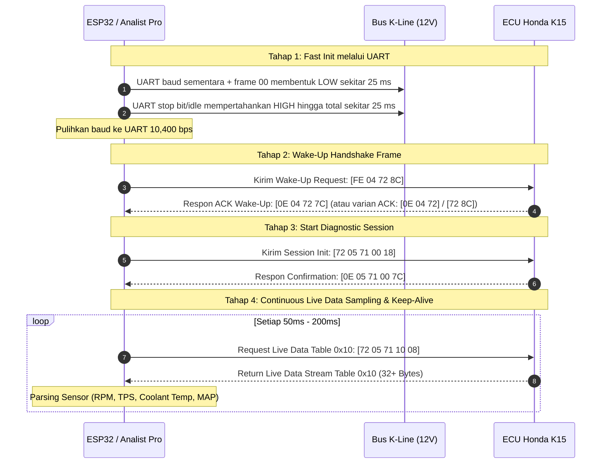

# Panduan Protokol & Langkah Komunikasi K-Line ECU Honda CB150R Old (K15)

Dokumen ini berisi dokumentasi teknis lengkap alur komunikasi K-Line untuk ECU Honda CB150R Old (K15 / part number `38770-K15-903` / `38770-K15-921`), berdasarkan dekodifikasi binary **ANALIST Pro 5.1.0** dan penyesuaian firmware ESP32 (`tinyml`).

---

## 📋 Ringkasan Parameter Utama

| Parameter | Spesifikasi | Keterangan |
| :--- | :--- | :--- |
| **Baud Rate** | `10,400 bps` | Terkunci (Fixed Baudrate), 8 Data Bits, No Parity, 1 Stop Bit (8N1) |
| **Sinyal Fisik K-Line** | Active LOW / Idle HIGH (12V) | Memerlukan K-Line Transceiver + Inversion Signal (TXD & RXD) |
| **Durasi Fast Init** | `25 ms` LOW, `25 ms` HIGH | Firmware ESP32 mempertahankan pin TX pada UART; pulsa LOW dibentuk dengan baud sementara dan frame `0x00` |
| **Inter-frame W4 Delay** | `0 ms` s/d `15 ms` | Delay batas transisi dari Fast Init ke pengiriman Wake-Up Frame |
| **Algoritma Checksum** | 2's Complement Sum | $(0x100 - (\sum \text{bytes} \pmod{256})) \pmod{256}$ |

---

## 🛠️ Alur Komunikasi Lengkap (Step-by-Step)



---

## 1️⃣ Tahap 1: Fast Init via UART

Sebelum komunikasi serial UART 10,400 bps dibuka, K-Line membutuhkan pulsa inisialisasi awal (*Fast Init*) untuk membangunkan ECU dari mode standby.

### Langkah Eksekusi:
1. **Pertahankan TX pada periferal UART**; firmware saat ini memakai baud sementara `360` untuk mengirim frame `0x00` 8N1. Start bit dan delapan bit data LOW membentuk pulsa bus LOW sekitar **`25 ms`** pada konfigurasi TX terinversi/transceiver inverting.
2. Stop bit dan kondisi UART idle membentuk level bus HIGH; firmware menahan fase HIGH hingga total sekitar **`25 ms`**.
3. **Pulihkan baud UART** ke `10,400 bps`, lalu tunggu W4 sebelum mengirim wake-up.
4. Parameter komunikasi UART normal:
   * Baud Rate: `10,400 bps`
   * Data Bits: `8 bits`, Stop Bits: `1 bit`, Parity: `None`
   * Inversion: `Active LOW / Line Inverted` (`UART_SIGNAL_TXD_INV | UART_SIGNAL_RXD_INV`).

> **Catatan validasi:** pendekatan baud sementara mempertahankan TX pada periferal UART, tetapi durasi dan polaritas pulsa aktual harus diverifikasi pada output transceiver/K-Line. UART RX ditahan pada level idle selama Fast Init agar pulsa tidak didekode sebagai byte RX.

---

## 2️⃣ Tahap 2: Wake-Up Handshake Frame & Penerimaan Byte

Setelah pulsa Fast Init selesai, ESP32/Analist Pro langsung memuat paket **Wake-Up Request** ke bus K-Line:

### Frame Request Wake-Up (TX):
$$\text{Payload:} \quad \mathbf{\texttt{[0xFE, 0x04, 0x72, 0x8C]}}$$

* `0xFE` : Header Khusus Short Fast-Wakeup
* `0x04` : Length (4 Bytes total)
* `0x72` : Target Address ECU Honda
* `0x8C` : Command / Handshake Key

### Byte Respon ACK dari ECU (RX yang Diterima):
Tergantung varian firmware ECU K15 Keihin di lapangan, ECU membalas salah satu dari 3 varian byte:
* **Respon Standar (4 Byte):** `[0x0E, 0x04, 0x72, 0x7C]`
* **Respon Varian Tanpa Checksum (3 Byte):** `[0x0E, 0x04, 0x72]`
* **Respon Short ACK (2 Byte):** `[0x72, 0x8C]`

---

## 3️⃣ Tahap 3: Start Diagnostic Session & Penerimaan Byte

Setibanya respon ACK Wake-Up, sistem wajib mengirim paket **Start Diagnostic Session** untuk mengunci status koneksi diagnostik pada ECU:

### Frame Request Start Session (TX):
$$\text{Payload:} \quad \mathbf{\texttt{[0x72, 0x05, 0x71, 0x00, 0x18]}}$$

* `0x72` : Target Address (ECU)
* `0x05` : Frame Length (5 Bytes)
* `0x71` : Service ID / Mode Request
* `0x00` : Sub-command / Initialization ID
* `0x18` : Checksum 2's Complement

### Byte Respon Konfirmasi ECU (RX yang Diterima):
$$\text{Payload ACK (5 Byte):} \quad \mathbf{\texttt{[0x0E, 0x05, 0x71, 0x00, 0x7C]}}$$

* `0x0E` : Sender Header (ECU Target ID = `0x0E`)
* `0x05` : Total Length Frame (5 Bytes)
* `0x71` : Service ID Confirmation
* `0x00` : Sub-command Confirm (Session Started)
* `0x7C` : Checksum 2's Complement ($0x100 - (0x0E + 0x05 + 0x71 + 0x00) = 0x7C$)

---

## 4️⃣ Tahap 4: Live Data Sampling & Penerimaan Stream Byte

Setelah sesi terkonfirmasi (`K-Line Session Initialized`), ESP32 membaca data sensor secara kontinu menggunakan permohonan **Table 0x10 Data Request**:

### Frame Request Live Data Table 0x10 (TX):
$$\text{Payload Request:} \quad \mathbf{\texttt{[0x72, 0x05, 0x71, 0x10, 0x08]}}$$

* `0x72` : Target Address
* `0x05` : Length (5 Bytes)
* `0x71` : Mode Read Data By ID
* `0x10` : Data Table ID (Table 0x10 untuk Live Sensor Data K15)
* `0x08` : Checksum $(0x100 - ((0x72 + 0x05 + 0x71 + 0x10) \pmod{256})) = 0x08$

---

## 📥 Rincian Stream Byte Respon ECU (Table 0x10 Data Stream)

ECU akan membalas dengan stream buffer data sepanjang **~34 Bytes**. Below adalah contoh urutan byte mentah (raw bytes) saat mesin dalam kondisi stasioner/idling beserta cara decoding per-byte-nya:

```text
[0x0E, 0x22, 0x71, 0x10, 0x00, 0x18, 0x05, 0xDC, 0x4B, 0x00, 0x00, 0x64, 0x00, 0x00, 0x00, 0x00, 0x00, 0x00, 0x00, 0x00, 0x00, 0x00, 0x00, 0x00, 0x00, 0x00, 0x00, 0x00, 0x00, 0x00, 0x00, 0x00, 0x00, 0xA7]
```

Frame respons diawali tiga byte header (`address`, `length`, `service`). Parser firmware mengembalikan byte setelah header sampai sebelum checksum sebagai `table_data`; karena itu `table_data[0]` adalah Table ID `0x10`, bukan byte address frame. Kolom indeks di bawah menunjukkan kedua jenis indeks untuk menghindari pergeseran offset.

| Index frame penuh | Indeks `table_data` firmware | Nilai Hex (Contoh) | Ukuran Data | Nama Parameter / Fungsi | Rumus Konversi Fisik | Hasil Nilai Terbaca |
| :--- | :--- | :--- | :--- | :--- | :--- | :--- |
| `frame[0]` | - | `0x0E` | 8-bit | Sender Header ID | Target Address ECU (`0x0E`) | ECU Honda |
| `frame[1]` | - | `0x22` (34) | 8-bit | Frame Length | Total Byte Respon Frame | 34 Bytes |
| `frame[2]` | - | `0x71` | 8-bit | Service ID Confirm | Read Data Confirmation | Service 0x71 |
| `frame[3]` | `table_data[0]` | `0x10` | 8-bit | Table ID Confirm | Table 0x10 Identification | Table 0x10 OK |
| `frame[4]` | `table_data[1]` | `0x00` | 8-bit | System Status | Diagnostic Status Byte | Status Normal |
| `frame[5]` | `table_data[2]` | `0x18` (24) | 8-bit Unsigned | **TPS Percent** | $\text{TPS} = \text{Byte}[2] \times 0.5$ | **12.0 %** |
| `frame[6]` | `table_data[3]` | `0x05` (5) | 16-bit Unsigned (MSB/High) | **Engine RPM** | $\text{RPM} = (\text{Byte}[3] \times 256) + \text{Byte}[4]$ | **1500 RPM** |
| `frame[7]` | `table_data[4]` | `0xDC` (220) | (LSB/Low) | | | |
| `frame[8]` | `table_data[5]` | `0x4B` (75) | 8-bit Unsigned | **Coolant Temp (ECT/EOT)** | $\text{Temp } (^\circ\text{C}) = \text{Byte}[5] - 40$ | **35 °C** |
| `frame[9]` | `table_data[6]` | `0x00` | 8-bit | O2 Sensor Voltage | O2 Sensor Raw Byte | - |
| `frame[10]` | `table_data[7]` | `0x00` | 8-bit | Battery Voltage | Aki Voltage Raw Byte | - |
| `frame[11]` | `table_data[8]` | `0x64` (100) | 8-bit Unsigned | **MAP (Manifold Pressure)** | $\text{MAP (kPa)} = \text{Byte}[8] \times 0.75$ | **75.0 kPa** |
| `frame[12-13]` | `table_data[9-10]` | `0x00 0x00` | 16-bit | Injector Pulse Width | Injector Duration (ms) | 0 ms |
| `frame[14]` | `table_data[11]` | `0x00` (0) | 8-bit Unsigned | **Vehicle Speed** | $\text{Speed} = \text{Byte}[11]$ | **0 km/h** |
| `frame[15-32]` | `table_data[12-29]` | `0x00 ...` | Variable | DTC & Data Tambahan | Kode Error / Reserved | Normal (No DTC) |
| `frame[33]` | - | `0xA7` | 8-bit | **Checksum** | 2's Complement Sum Validation | Checksum Valid |

---

## 🔒 Algoritma Kalkulasi Checksum (2's Complement Sum)

Seluruh paket K-Line Honda (kecuali Short Wake-Up Frame `FE 04`) menggunakan checksum 2's complement di akhir byte paket:

```c
uint8_t kwp2000_calculate_checksum(uint8_t *data, uint8_t len) {
    uint16_t sum = 0;
    for (int i = 0; i < len; i++) {
        sum += data[i];
    }
    return (uint8_t)(0x100 - (sum & 0xFF));
}
```

Dengan rumus tersebut, checksum contoh frame table pada dokumen adalah `0xA7` (bukan `0xA3`). Nilai contoh ini hanya konsisten secara matematis; validasi format terhadap ECU tetap memerlukan capture respons ECU yang nyata.

---

## 🔍 Checklist Troubleshooting Lapangan

Jika ESP32 gagal membaca ECU di motor:

1. **Pengujian Tegangan Hardware (K-Line Transceiver):**
   * Gunakan fitur **TX Hardware Test** di Web Dashboard ESP32.
   * `Force TX HIGH` $\rightarrow$ Tegangan K-Line harus **~12V**.
   * `Force TX LOW` $\rightarrow$ Tegangan K-Line harus **< 0.5V**.
2. **K-Line Inversion Signal Check:**
   * Jika transceiver hardware Anda sudah memiliki inverter transistor internal, matikan invert signal di kode software agar sinyal tidak terbalik 2x (*Double Inversion*).
3. **Pembersihan TX Echo:**
   * K-Line menggunakan transmisi 1 kawat (*Half-Duplex*). Pastikan fungsi `kwp_consume_last_tx_echo()` aktif untuk membuang pantulan data TX dari buffer RX sebelum memproses respon ECU.
